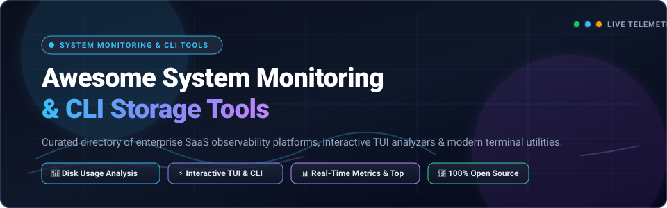

  

  
  
  
  
  
  

---

# 🚀 Awesome System Monitoring & CLI Tools

> **The definitive curated index of enterprise SaaS observability platforms, cloud storage analyzers, and high-performance open-source terminal (CLI & TUI) system monitoring utilities.**

Whether you are debugging unexpected disk exhaustion on remote production Kubernetes clusters, inspecting CPU/memory telemetry via SSH, discovering bloated Docker container layers, or seeking visual treemaps to reclaim gigabytes on local workstations, this guide curates the modern system monitoring ecosystem.

---

## 📑 Table of Contents

- [🔍 Sector Overview & Market Dynamics](#-sector-overview--market-dynamics)
- [🏢 SaaS & Commercial Observability Platforms](#-saas--commercial-observability-platforms)
- [💻 Open-Source CLI & TUI System Monitoring Utilities](#-open-source-cli--tui-system-monitoring-utilities)
  - [Top-Tier Repositories (Ranked by GitHub Stars)](#top-tier-repositories-ranked-by-github-stars)
- [🛠️ Tool Selection Matrix & Workflow Recommendations](#️-tool-selection-matrix--workflow-recommendations)
- [🤝 How to Contribute](#-how-to-contribute)
- [⚖️ Disclaimer](#️-disclaimer)
- [⭐ Star History](#-star-history)
- [☕ Support & Sponsorship](#-support--sponsorship)

---

## 🔍 Sector Overview & Market Dynamics

The global **IT Infrastructure and System Monitoring Market** is valued at approximately **$4.8 billion in 2024** and is projected to expand to **$9.6 billion by 2030**, reflecting a compound annual growth rate (CAGR) of **12.2%**.

From a market structure perspective, the ecosystem exhibits **bifurcated dynamics**:
1. **Oligopolistic Concentration at the Cloud & Enterprise SaaS Layer**: Enterprise full-stack observability is heavily concentrated among a handful of multi-billion-dollar market leaders (Datadog, Dynatrace, New Relic) that capture the majority of Fortune 500 infrastructure spend through unified ingestion of logs, metrics, traces, and storage telemetry.
2. **High Fragmentation at the Local Utility & Terminal CLI Layer**: Conversely, individual machine monitoring, disk usage analysis, and terminal-based interactive inspection are **highly fragmented**. Independent developers and open-source communities produce specialized, single-binary Rust and Go utilities (such as `btop`, `duf`, `dust`, `ncdu`, and `gdu`) that outpace monolithic tools in raw execution speed, memory safety, and terminal ergonomic experience.

---

## 🏢 SaaS & Commercial Observability Platforms

The table below summarizes leading commercial platforms for system telemetry, host health monitoring, and disk space visualization, sorted in **descending order by company valuation / annual revenue**.

| Product & Platform | Company Size (Valuation / Revenue) | Starting Pricing (Specific) | Free Tier Limits (Specific) | Core Capabilities & Focus |
| :--- | :--- | :--- | :--- | :--- |
| **[Datadog Infrastructure](https://www.datadoghq.com/)** 📊 | **~$42.0 Billion** Market Cap (NASDAQ: DDOG) | **$15.00** / host / month (Pro tier, billed annually) or **$18.00** on-demand | **14-day free trial** with full platform access for up to 5 hosts; **Free Forever plan** limited to 5 hosts with 1-day metric retention | Comprehensive cloud and on-premise infrastructure monitoring, automated host health alerting, and disk I/O metrics. |
| **[Dynatrace Infrastructure](https://www.dynatrace.com/)** ⚡ | **~$15.0 Billion** Market Cap (NYSE: DT) | **$0.04** / hour per 8 GiB host (~**$29.00** / host / month) | **15-day free trial** including **1,000 monitoring hours** with complete full-stack observability features | AI-powered Davis engine telemetry, automated root-cause analysis, container storage, and cluster host tracking. |
| **[New Relic Infrastructure](https://newrelic.com/)** 📈 | **~$6.5 Billion** Valuation (Francisco Partners / TPG) | **$0.30** / GB data ingest beyond free allocation; **$99.00** / user / month (Standard plan) | **100 GB/month free data ingest forever** for 1 full-platform user with full access to 30+ observability tools | Centralized telemetry data platform with automated host discovery, storage volume alerts, and Kubernetes pod monitoring. |
| **[LogicMonitor](https://www.logicmonitor.com/)** 🛡️ | **~$2.4 Billion** Valuation (Vista Equity Partners) | **$22.00** / device / month (Pro tier, annual commitment) | **14-day free trial** supporting automated discovery and telemetry for up to **50 devices** | Agentless SaaS monitoring for hybrid IT environments, physical server storage arrays, SAN/NAS, and network devices. |
| **[ManageEngine OpManager](https://www.manageengine.com/network-monitoring/)** 🖥️ | **~$1.1 Billion** Annual Revenue (Zoho Corporation) | **$245.00** / year (Standard Edition for 10 devices) | **30-day free trial** supporting up to **100 devices**; **Free Edition** available forever for up to **3 devices** | End-to-end server monitoring, disk usage thresholds, RAID/storage arrays, and SNMP/WMI system health dashboards. |
| **[Paessler PRTG Network Monitor](https://www.paessler.com/prtg)** 🌐 | **~$75.0 Million** Annual Revenue (Paessler AG) | **$1,899.00** one-time perpetual license (PRTG 500) or **$159.00** / month | **100 sensors free forever**; initial installation includes **30 days of unlimited sensors** with no credit card required | Comprehensive sensor-based Windows/Linux server monitoring, disk drive free space alerts, and bandwidth usage tracking. |
| **[Stardock SpaceMonger](https://www.stardock.com/products/spacemonger/)** 🗂️ | **~$25.0 Million** Annual Revenue (Stardock Corp) | **$14.99** one-time perpetual license per PC | **30-day fully functional free trial** with complete drive scanning and treemap visualizer | Fast Windows desktop drive scanning, dynamic treemaps, duplicate file identification, and external volume management. |
| **[TreeSize Professional](https://www.jam-software.com/treesize/)** 🌳 | **~$10.0 Million** Annual Revenue (JAM Software GmbH) | **$49.00** / user / year (or **$59.95** one-time perpetual license) | **30-day fully functional free trial** with no file size limitations; **TreeSize Free** available forever for basic scanning | Enterprise NTFS/MFT disk space manager, deduplication scanner, scheduled reporting (PDF/Excel), and cloud storage scans (SharePoint/Azure). |
| **[WizTree](https://diskanalyzer.com/)** ⚡ | **~$3.0 Million** Annual Revenue (Antibody Software) | **$29.95** single-user commercial license (or **$49.95** commercial site license) | **Free forever for personal / non-commercial use** with 100% full scanning speed; commercial usage requires a paid license | High-speed Windows disk analyzer that directly reads the NTFS Master File Table (MFT) to index multi-terabyte drives in seconds. |
| **[DaisyDisk](https://daisydiskapp.com/)** 🍏 | **~$3.0 Million** Annual Revenue (Software Ambience Corp) | **$9.99** one-time purchase (covers up to 5 personal Macs) | **Unlimited-duration free trial** for scanning and sunburst visualization; in-app file deletion and cloud scans locked | Acclaimed macOS disk analyzer with an interactive radial sunburst interface and purgeable system cache cleanup. |
| **[Folder Size Pro](https://www.mindgems.com/products/Folder-Size/Folder-Size.html)** 📁 | **~$1.5 Million** Annual Revenue (MindGems Inc) | **$24.95** one-time personal license (**$49.95** professional license) | **Free version available forever** for basic scans; file filters, XML/CSV export, and command-line automation locked | Automated Windows folder size calculator displaying bar graphs, pie charts, and largest file distribution summaries. |

---

## 💻 Open-Source CLI & TUI System Monitoring Utilities

The following open-source utilities provide terminal-based process inspection, hardware telemetry, filesystem browsing, and disk usage visualization. They are ranked in **descending order by GitHub star count**.

### Top-Tier Repositories (Ranked by GitHub Stars)

1. **[dive](https://github.com/wagoodman/dive)**  🐳  
   *A tool for exploring a docker image, layer contents, and discovering ways to shrink your image size.*  
   - **Highlights**: Breaks down container layers, highlights modified/deleted files contributing to wasted storage, and integrates into CI pipelines with custom efficiency thresholds.  
   - **Install**: `brew install dive` or `docker run --rm -it -v /var/run/docker.sock:/var/run/docker.sock wagoodman/dive:latest <image-tag>`

2. **[btop](https://github.com/aristocratos/btop)**  🎛️  
   *A modern, responsive C++ resource monitor displaying processor, memory, disks, network, and processes.*  
   - **Highlights**: Gorgeous responsive TUI layout, full mouse support, real-time disk I/O activity graphs, and hardware temperature sensors.  
   - **Install**: `brew install btop` or `apt install btop` or `pacman -S btop`

3. **[Glances](https://github.com/nicolargo/glances)**  👁️  
   *Glances an Eye on your system. A top/htop alternative for GNU/Linux, BSD, Mac OS and Windows.*  
   - **Highlights**: Written in Python; features a standalone curses TUI, a built-in Web GUI (`glances -w`), and a REST JSON API for remote server fleet telemetry.  
   - **Install**: `pip install glances` or `brew install glances`

4. **[fastfetch](https://github.com/fastfetch-cli/fastfetch)**  🚀  
   *A maintained, feature-rich and performance-oriented neofetch-like tool for system information display written in C.*  
   - **Highlights**: Blazingly fast boot/login telemetry summary of OS version, kernel, CPU, GPU, memory, and mounted disk partitions.  
   - **Install**: `brew install fastfetch` or `apt install fastfetch` or `scoop install fastfetch`

5. **[eza](https://github.com/eza-community/eza)**  📂  
   *A modern, actively maintained replacement for ls written in Rust.*  
   - **Highlights**: Color-coded file metadata, Git status integration, extended file attributes, file size bar charts, and recursive tree navigation (`eza --tree`).  
   - **Install**: `cargo install eza` or `brew install eza`

6. **[ctop](https://github.com/bcicen/ctop)**  📦  
   *Top-like interface for container metrics across Docker and Kubernetes runtimes.*  
   - **Highlights**: Real-time CPU, memory, network, and block I/O bandwidth tracking for active containers with a single terminal dashboard.  
   - **Install**: `brew install ctop` or download standalone Go binary

7. **[duf](https://github.com/muesli/duf)**  📊  
   *Disk Usage/Free Utility — a modern, colorized, and human-friendly replacement for `df`.*  
   - **Highlights**: Color-coded storage bars, automatic device classification (local, network, pseudo filesystems), JSON export, and flexible `--sort` options.  
   - **Install**: `brew install duf` or `apt install duf` or `go install github.com/muesli/duf@latest`

8. **[bottom](https://github.com/ClementTsang/bottom)**  📉  
   *Yet another cross-platform graphical process/system monitor in Rust.*  
   - **Highlights**: Fully customizable dashboard widgets for CPU, RAM, disk read/write throughput, temperature sensors, and process termination.  
   - **Install**: `cargo install bottom` or `brew install bottom` or `scoop install bottom`

9. **[broot](https://github.com/Canop/broot)**  🌲  
   *A new way to see and navigate directory trees in the terminal.*  
   - **Highlights**: Calculates aggregate directory sizes during navigation, applies fuzzy searches across deep filesystem hierarchies, and launches shell actions.  
   - **Install**: `cargo install broot` or `brew install broot`

10. **[dust](https://github.com/bootandy/dust)**  🧹  
    *A more intuitive version of du written in Rust.*  
    - **Highlights**: Shows directory sizes as an ASCII tree bar chart, aggregates hard links correctly, and scans multi-core filesystems in parallel.  
    - **Install**: `cargo install du-dust` or `brew install dust`

11. **[bandwhich](https://github.com/imsnif/bandwhich)**  📡  
    *CLI terminal bandwidth utilization tool that attributes network traffic to specific running processes.*  
    - **Highlights**: Sniffs live network interface packets, resolves hostnames asynchronously, and shows real-time upload/download speeds per PID.  
    - **Install**: `cargo install bandwhich` or `brew install bandwhich`

12. **[htop](https://github.com/htop-dev/htop)**  📋  
    *The industry standard interactive process viewer for Unix systems.*  
    - **Highlights**: Colorized per-core CPU meters, interactive process tree hierarchy, keyboard shortcuts for sending signals (`SIGTERM`, `SIGKILL`), and sorting.  
    - **Install**: Standard package manager (`apt install htop`, `brew install htop`, `yum install htop`)

13. **[dua-cli](https://github.com/Byron/dua-cli)**  ⚡  
    *View disk space usage and delete unwanted data, fast (in Rust).*  
    - **Highlights**: Blazing multi-threaded directory walking with an interactive TUI mode (`dua i`) supporting directory traversal and queued file deletion.  
    - **Install**: `cargo install dua-cli` or `brew install dua-cli`

14. **[procs](https://github.com/dalance/procs)**  🔍  
    *A modern replacement for ps written in Rust.*  
    - **Highlights**: Automatic multi-color columns, keyword search across PID/user/command, Docker container name resolution, and CPU/memory percentage indicators.  
    - **Install**: `cargo install procs` or `brew install procs`

15. **[gdu](https://github.com/dundee/gdu)**  🏃  
    *Fast disk usage analyzer with console interface written in Go.*  
    - **Highlights**: Significantly faster than classic `ncdu` on large SSD/NVMe drives due to parallel directory scanning; handles sparse files and JSON outputs.  
    - **Install**: `brew install gdu` or `curl -L https://github.com/dundee/gdu/releases/latest/download/gdu_linux_amd64.tgz | tar xz`

16. **[diskonaut](https://github.com/imsnif/diskonaut)**  🗺️  
    *Terminal visual disk space navigator written in Rust.*  
    - **Highlights**: Draws an interactive treemap directly within your terminal window; navigate into rectangular storage blocks and delete space hogs with confirmation.  
    - **Install**: `cargo install diskonaut` or `brew install diskonaut`

17. **[gotop](https://github.com/xxxserxxx/gotop)**  📈  
    *A terminal-based graphical activity monitor inspired by gtop and vtop, written in Go.*  
    - **Highlights**: Clean minimalist CPU/memory sparkline charts, disk mount tables, network throughput graphs, and configurable color schemes.  
    - **Install**: `brew install gotop` or download precompiled release binary

18. **[zenith](https://github.com/bvaisvil/zenith)**  🏔️  
    *Sort of like top or htop, but with zoom-able history charts, CPU, GPU, memory, disk, and network stats.*  
    - **Highlights**: Features NVIDIA/AMD GPU utilization graphs, disk I/O metrics, and zoomable temporal charts navigating historical performance bottlenecks.  
    - **Install**: `cargo install zenith` or `brew install zenith`

19. **[erdtree](https://github.com/solidiquis/erdtree)**  🌱  
    *A modern, cross-platform, multi-threaded file-tree and disk usage analyzer in Rust.*  
    - **Highlights**: Combines features of `tree`, `du`, and `find`; respects `.gitignore` rules, supports custom depth thresholds, and renders Nerd Font icons.  
    - **Install**: `cargo install erdtree` or `brew install erdtree`

20. **[nat](https://github.com/willdoescode/nat)**  🎨  
    *`ls` alternative with useful file information and a splash of color.*  
    - **Highlights**: Displays directory contents with Nerd Font file icons, human-readable byte sizes, file permissions, and tree views (`nat ls -T`).  
    - **Install**: `cargo install nat-ls`

21. **[ncdu](https://github.com/rofl0r/ncdu)**  📟  
    *NCurses Disk Usage analyzer for POSIX systems.*  
    - **Highlights**: Ultra-lightweight C implementation with zero dependencies; export and import scan snapshots (`ncdu -o scan.json`) for remote offline triage.  
    - **Install**: `apt install ncdu` or `brew install ncdu` or `pacman -S ncdu`

22. **[duc](https://github.com/zevv/duc)**  🗃️  
    *Library and suite of indexing tools for inspecting and visualizing disk usage across hundreds of millions of files.*  
    - **Highlights**: Indexes filesystem state into an embedded database (Tokyo Cabinet / SQLite) for instant rescanning without repeated full disk traversal.  
    - **Install**: `apt install duc` or build from source

23. **[godu](https://github.com/viktomas/godu)**  🧭  
    *Simple, fast Go utility for discovering large files and folders.*  
    - **Highlights**: Minimalist keyboard navigation, clean split view, and fast parallel scanning for home directories and server volumes.  
    - **Install**: `go install github.com/viktomas/godu@latest`

24. **[tin-summer](https://github.com/vmchale/tin-summer)**  ☀️  
    *Find build artifacts and visualize disk usage (in Haskell).*  
    - **Highlights**: Optimized CLI command `sn` with subcommands (`sn f`, `sn ar`, `sn d`) specifically tuned to detect bloated build caches (Node `node_modules`, Rust `target`, Go build caches).  
    - **Install**: `cargo install tin-summer` or `cabal install tin-summer`

25. **[dirstat-rs](https://github.com/scullionw/dirstat-rs)**  ⚡  
    *Fast disk usage CLI in Rust, inspired by WinDirStat.*  
    - **Highlights**: Multi-core recursive directory traversal via `rayon`, depth limits, and clean scriptable JSON output pipelines.  
    - **Install**: `cargo install dirstat-rs`

---

## 🛠️ Tool Selection Matrix & Workflow Recommendations

| Use Case / Scenario | Recommended Primary Tool | Runner-Up / Alternative | Why This Tool Excels |
| :--- | :--- | :--- | :--- |
| **Instant Mountpoint Free Space Summary** | `duf` | `df -h` | Modern color-coded tabular summary, auto-categorizes pseudo filesystems, and filters by mountpoint. |
| **Quick "What is Taking Up Space Here?"** | `dust` | `gdu` | Instantly prints an ASCII hierarchy tree bar chart without needing an interactive TUI session. |
| **Interactive Terminal Directory Triage** | `gdu` / `dua-cli` | `ncdu` | Parallel multi-threaded scanning utilizes all CPU cores on NVMe drives; queued file deletion. |
| **Full Server & Process Telemetry** | `btop` | `bottom` / `glances` | Rich responsive UI, real-time disk read/write bandwidth, process signals, and thermal telemetry. |
| **Remote Host Fleet Observability** | `Glances` | `Datadog` / `PRTG` | Built-in Web GUI mode (`glances -w`) and REST JSON API allows monitoring servers without desktop agents. |
| **Docker & Container Layer Bloat** | `dive` | `ctop` | Dissects container image layers down to each byte to uncover accidentally packed build caches. |
| **Massive Filesystems (>100M files)** | `duc` | `TreeSize Pro` | Database indexing enables instant sub-second queries without rescanning disks repeatedly. |
| **High-Speed Windows Desktop Analysis** | `WizTree` | `TreeSize Pro` | Reads NTFS Master File Table (MFT) directly, completing scans in 2 seconds where others take 10 minutes. |
| **macOS Native Visual Disk Cleanup** | `DaisyDisk` | `dust` | Polished sunburst visualization cleanly isolates macOS purgeable disk caches and hidden space. |

---

## 🤝 How to Contribute

Contributions are warmly welcomed! Help keep this directory accurate, up-to-date, and comprehensive:

1. **Fork** the repository: [https://github.com/ishandutta2007/Awesome-System-Monitoring-CLI-Tools](https://github.com/ishandutta2007/Awesome-System-Monitoring-CLI-Tools).
2. **Create a topic branch**: `git checkout -b feature/add-new-monitoring-tool`.
3. **Add or refine an entry** following existing formats:
   - For **SaaS**: specify exact starting tier pricing, explicit free tier / trial limitations, and company valuation/revenue metrics.
   - For **Open-Source**: include owner/repo link, star badge (`style=social&color=white`) linking to the stargazers page, key highlights, and installation command.
4. **Submit a Pull Request** with a concise description of the added tool and why it fits the ecosystem.

---

## ⚖️ Disclaimer

- This repository is a community-curated educational index. Product names, logos, and brands are property of their respective owners.
- Scanning speeds differ significantly across platforms: MFT-based readers like **WizTree** achieve unmatched speed on local NTFS volumes, whereas POSIX utilities rely on multi-threaded filesystem traversal.
- Deletions initiated from terminal storage utilities (`ncdu`, `gdu`, `dua`, `diskonaut`) bypass operating system recycling bins and are permanent. Always verify directory paths and take necessary backups prior to executing deletions.

---

## ⭐ Star History

---

## ☕ Support & Sponsorship

Thank you for exploring this curated directory! If you found this repository helpful for diagnosing disk bottlenecks, discovering slick terminal monitoring tools, or configuring system metrics:

- ⭐ **Star this repository** to keep track of new tools and updates.
- 🍴 **Fork and contribute** your favorite CLI utilities or monitoring scripts.
- 📢 **Share** with your fellow sysadmins, DevOps engineers, and terminal aficionados.
- 💖 **Sponsor / Buy a Coffee**: Support continuous open-source curation via the [GitHub Sponsors Dashboard](https://github.com/sponsors/ishandutta2007).

---

  Part of the <a href="https://github.com/ishandutta2007/Awesome-Awesome-Awesome">Awesome Lists Collection</a>. Maintained with care by <a href="https://github.com/ishandutta2007">Ishan Dutta</a> and community contributors.

